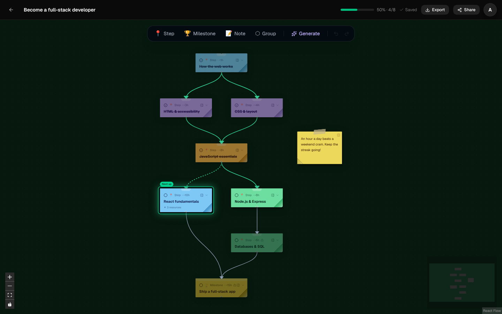
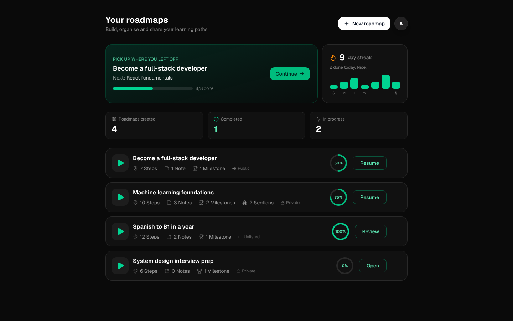
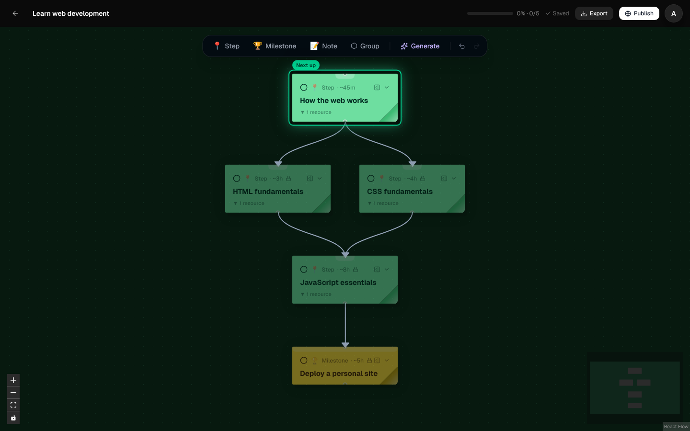
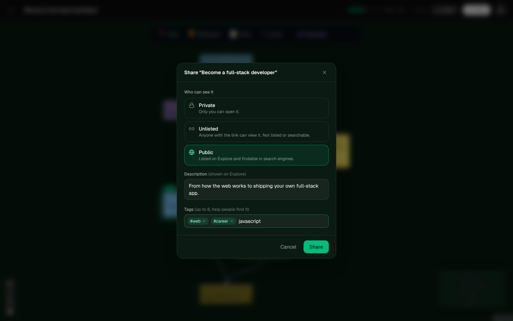
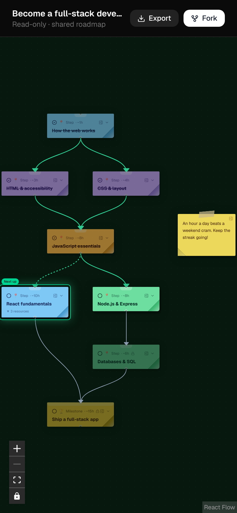
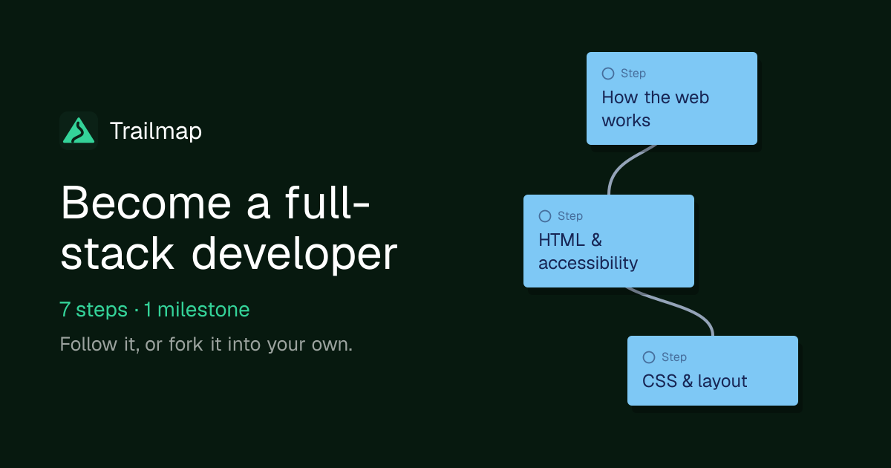
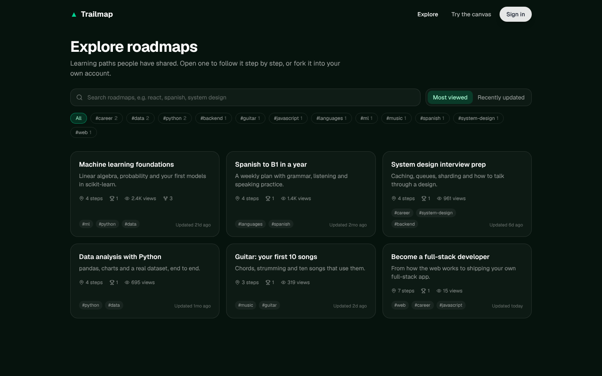

<p align="center">
  
</p>

<h1 align="center">Trailmap</h1>

<p align="center">
  Build learning roadmaps as a visual trail of steps and milestones, track your progress, and share them with anyone.
</p>

<p align="center">
  
</p>

> Screenshots throughout this README use synthetic data.

## Features

**A canvas for your learning path.** Steps, milestones, notes and groups live on an infinite canvas. Connect them in order and Trailmap keeps the graph acyclic, so prerequisites always make sense. Each step can hold resources: rich-text notes, links, YouTube videos, images and checklists.

**See where you are.** Tick steps off as you go:
- Edges along the trail you've finished turn green.
- The next unlocked step glows with a "Next up" tag.
- Steps whose prerequisites aren't done yet are dimmed and locked.
- Finishing a roadmap sets off confetti.

<p align="center">
  
</p>

**A dashboard that brings you back.** Each visit opens on:
- a "Pick up where you left off" card that jumps straight to your next step;
- a daily streak and a 7-day activity chart;
- your progress on every roadmap.

<p align="center">
  
</p>

**Start in seconds.** A new roadmap offers three ways in:
- add your first step;
- describe a goal and let AI draft the roadmap;
- start from a template.

| Blank roadmap | From a template |
| --- | --- |
|  |  |

**Share and fork.** The **Share** button (in the editor, or a roadmap's menu on the dashboard) sets who can see it:
- **Private:** only you.
- **Unlisted:** anyone with the link can view it, but it isn't listed anywhere and isn't indexed by search engines.
- **Public:** also listed on Explore and in the sitemap, with a description and tags.

Nothing changes until you save, and **Stop sharing** turns the link off. Sharing again brings back the same link.

<p align="center">
  
</p>

Shared roadmaps open without an account and work on phones. Signed-in visitors can track their own progress on one or fork it into their account. Shared links unfurl with a preview card on WhatsApp, Slack, iMessage and X. Roadmaps also export to PNG, PDF or JSON.

| Shared roadmap on a phone | Link preview |
| --- | --- |
|  |  |

**AI help on every step.** In a step's side panel:
- **Suggest next steps** proposes three steps to follow it; **Add** puts one on the canvas, connected.
- **Find resources** suggests videos, docs and practice to look for. They're search links (YouTube or the web): the model never writes URLs itself.

Generation is limited per user per day (10 roadmaps, 30 suggestions on the free plan), and token use is recorded.

**Track what you're working on.** A step can be to do, in progress or done. The "Next up" glow and the dashboard's resume card prefer a step that's in progress.

**Follow roadmaps.** Follow someone's shared roadmap to keep it, with your progress, under **Following** on your dashboard.

**Tidy up.** One click lays the trail out top to bottom by prerequisites, keeping crossings down. It's a single undo step.

**Safe saving.**
- Edits autosave. If the same roadmap was saved in another tab or on another device, the save is refused and you choose which version to keep. A tab with no unsaved edits picks up the other version when you come back to it.
- Unsaved edits are also kept on the device, so after a crash, a closed tab or a failed save you're offered them back.
- Errors show as toasts, and unknown pages get a branded 404.

**Explore.** `/explore` lists every public roadmap, with no sign-in needed. You can search by title, description or tag, filter by tag, and sort by most viewed or recently updated. Each card shows step counts, views and forks. The **Templates** tab is a gallery of roadmaps featured by admins (`ADMIN_EMAILS`); "Use this template" copies one, and a new roadmap's template picker lists them too.

<p align="center">
  
</p>

**Local-first.** `/try` gives anyone a full canvas with no account. It saves to the browser (IndexedDB), and after signing in you can move those roadmaps into your account in one click.

<p align="center">
  
</p>

## Tech stack

| | |
| --- | --- |
| **Frontend** (`frontend/`) | Next.js 16 (App Router), React 19, Tailwind CSS v4, React Flow (`@xyflow/react`), Zustand + zundo (undo/redo), TanStack Query, TipTap, Dexie (IndexedDB), NextAuth v5 (JWT sessions) |
| **Backend** (`backend/`) | Express, Prisma 7 with the Neon serverless driver, Postgres (Neon), Cloudinary (image uploads), LangChain + OpenRouter (AI generation), Zod |
| **Hosting** | Frontend on Vercel, backend on Railway |

The browser only talks to the Next.js app. Signed-in API calls go through a same-origin proxy (`frontend/app/api/proxy/[...path]`), which turns the httpOnly session cookie into a Bearer token for the backend. The backend verifies that token with the shared `AUTH_SECRET`, so there's no session table. [`ARCHITECTURE.md`](ARCHITECTURE.md) covers the design in depth: data model, API contract, sync strategy and AI pipeline.

```
.
├── frontend/          Next.js app (UI, auth, API proxy)
│   ├── app/           Routes: /, /explore, /try, /login, /dashboard, /roadmap/[id], /r/[slug]
│   ├── components/    Canvas, nodes, content blocks, dashboard, landing
│   ├── store/         Zustand stores (canvas, progress, UI)
│   └── lib/           API client, local DB, path state, templates
├── backend/           Express REST API
│   ├── src/routes/    roadmaps, public (/r), explore, progress, ai, uploads, youtube
│   └── prisma/        Database schema
└── docs/screenshots/  Images used in this README
```

## Running locally

### Prerequisites

- Node.js 22 or newer
- A [Neon](https://neon.tech) Postgres database. The backend uses Neon's serverless (WebSocket) driver, so a plain local Postgres won't work without swapping the Prisma adapter in `backend/src/db/prisma.ts`.
- Optional:
  - Google OAuth credentials, for sign-in in production. Development has a built-in dev login.
  - A Cloudinary account, for image uploads.
  - An OpenRouter key, for AI generation.

### 1. Backend

```bash
cd backend
npm ci                 # also runs prisma generate
# create .env with the values below
npx prisma db push     # create the tables in your database
npm run dev            # http://localhost:4000
```

`backend/.env`:

```bash
PORT=4000                                  # the frontend expects 4000 by default
DATABASE_URL=postgresql://…neon.tech/…     # Neon connection string
AUTH_SECRET=…                              # same value as the frontend; 32+ characters
FRONTEND_ORIGIN=http://localhost:3000      # for CORS, and the link in sign-in emails
PROXY_SECRET=…                             # same value as the frontend; required in production (see below)

# Optional
CLOUDINARY_CLOUD_NAME=
CLOUDINARY_API_KEY=
CLOUDINARY_API_SECRET=
OPENROUTER_API_KEY=                        # AI generate, suggest-next and find-resources
OPENROUTER_MODEL=                          # defaults to a free OpenRouter model
BREVO_API_KEY=                             # sign-in emails; without it, development prints the link to the console
BREVO_FROM_EMAIL=noreply@your-domain       # a sender verified in Brevo
YOUTUBE_API_KEY=                           # YouTube Data API v3: video durations and playlist sizes (else oEmbed)
ADMIN_EMAILS=you@example.com               # comma-separated; these accounts can feature templates
TRUST_PROXY_HOPS=1                         # proxies in front of the backend (Railway: 1)
```

### 2. Frontend

```bash
cd frontend
npm ci
npx prisma generate
npm run dev            # http://localhost:3000
```

`frontend/.env.local`:

```bash
AUTH_SECRET=…                              # same value as the backend
BACKEND_URL=http://localhost:4000
PROXY_SECRET=…                             # same value as the backend

# Optional
AUTH_GOOGLE_ID=
AUTH_GOOGLE_SECRET=
NEXT_PUBLIC_SITE_URL=https://your-domain   # absolute URLs for share previews, sitemap, robots
```

Generate a secret with `openssl rand -hex 32`.

Sign-in is Google or an emailed one-time link. In development, without `BREVO_API_KEY`, the backend prints the link to its console instead of sending it, and the login page also has a **dev login** that signs any email in at once.

**`PROXY_SECRET`.** Browser requests reach the backend through the Next.js proxy, so the backend would otherwise see one IP (the frontend server's) for every user. The proxy forwards the visitor's IP with this shared secret, and the backend only trusts that header when the secret matches. It's used for the per-IP rate limits and for counting one view per visitor. Without it, all users share the limits.

**Schema changes.** After pulling changes to `backend/prisma/schema.prisma`, run `npx prisma db push` in `backend/` against your database.

### Checks

```bash
cd frontend && npx eslint && AUTH_SECRET=x npx next build
cd backend && npx tsc --noEmit
```

## Deployment

- **Frontend (Vercel):**
  - Set the project root to `frontend/`.
  - Set `AUTH_SECRET`, `BACKEND_URL`, `PROXY_SECRET`, `AUTH_GOOGLE_ID`, `AUTH_GOOGLE_SECRET` and `NEXT_PUBLIC_SITE_URL`.
  - Without `NEXT_PUBLIC_SITE_URL`, link previews fall back to the Vercel production domain.
- **Backend (Railway):**
  - Set the root to `backend/`. The build command is `npm run build` and the start command is `npm start`.
  - Set the variables from `backend/.env`, with `FRONTEND_ORIGIN` set to the frontend's URL.
